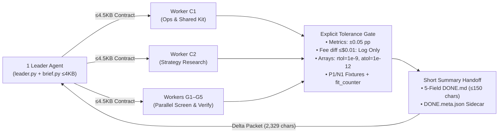

# Jiarong Li — Builder Portfolio & Multi-Agent Quantitative Research (`strategy-vault`)

> **Public Engineering Showcase & Mini-Portfolio**
> Independent builder exploring AI agent workflows, quantitative market research, and applied fintech tools.
> **Live Portfolio & Interactive Showcase:** [https://animeinc.github.io/strategy-vault-showcase/](https://animeinc.github.io/strategy-vault-showcase/)
> **Status:** `Work in Progress / Testing`

---

## Overview & Projects

This repository powers my public portfolio page (`index.html`) and documents the engineering architecture behind two independent projects built since September 2026:

1. **`strategy-vault` — AI-Assisted U.S. Equity Strategy Research & Leader–Worker Multi-Agent Backtesting System** *(Primary Deep Dive)*
   - Rule-based daily trading strategy research across U.S. equities (`1927–2026` historical panels), orchestrated via a custom **1 Leader + Parallel Workers** multi-agent workflow with explicit numerical error tolerances and compact summary handoffs.
2. **`TariffDesk` — AI Customs Classification & Landed-Cost Engine for Shopify Merchants** *(Independent Project, In Testing)*
   - Built with AI coding agents to assign **HS/HTS customs codes** to every product in a merchant's catalogue, cite the legal basis (General Rules of Interpretation & Chapter Notes), and calculate **Section 301 tariffs & landed cost**.
   - Enforces a deterministic **Three-Tier Confidence Protocol**:
     - **Tier 1 (`Auto-Apply`)**: High confidence; unambiguous material and function match.
     - **Tier 2 (`Flag for Human Review`)**: Medium confidence (e.g., composite goods under GRI 3(b) where tariff rates diverge); surfaces the duty spread for merchant confirmation.
     - **Tier 3 (`Refuse to Guess`)**: Insufficient product specification evidence; explicitly halts rather than hallucinating a customs code that could create compliance liability.

---

## 1. Why I Started `strategy-vault`

In early 2026, I started trading U.S. stocks and quickly discovered that my largest losses came from **emotional, momentum-chasing decisions**—buying late into rallies and panic-selling into short-term drawdowns.

To take emotion out of the decision loop, I set out to use AI agents to research, implement, and backtest a strictly **rule-based daily trading strategy for U.S. stocks**.

---

## 2. Core Engineering Iteration: Fixing the Multi-Agent Loop

### The Early Pain Point: Infinite Review & Rerun Loops
Initially, I set up multiple peer agents to separately gather market data, run backtests, and review results. Because the agents lacked a formal definition of **"what counts as good enough,"** they repeatedly got trapped in infinite review-and-rerun loops over trivial floating-point or rounding differences (such as a `0.001%` float order discrepancy or a `$0.01` rounding difference on reference transaction cost tables). Meanwhile, passing full conversation histories across turns caused context size to balloon from `~43k` tokens on turn 1 to `~238k` tokens by turn 8, rapidly burning through my token budget.

### The Refactor: Leader–Worker + Explicit Tolerances + Summary Handoffs



1. **1 Leader + Parallel Worker Queues**: Rebuilt the workflow around a single Leader Agent (`leader.py`) that compiles self-contained task contracts (`≤ 4,500 UTF-8 bytes`) with pre-verified data hashes and positive/negative test fixtures (`g5-pos.json` / `g5-neg.json`). Parallel Worker Agents (`C1`, `C2`, `G1–G5`) claim tasks atomically from isolated slot queues.
2. **Explicit Error Tolerances (`Decision 39`)**: Defined strict numerical tolerances for every verification check:
   - **Account-Level Metrics (`CAGR`, `Daily MaxDD`, `Calmar`)**: `±0.05` percentage points (`0.0005`).
   - **Reference Cost & Fee Rounding**: Single-row differences `≤ $0.01` and full-batch differences `≤ $0.05` are **logged as an audit note and halted**—never re-run—provided trade direction, constituent lists, and gate verdicts are unchanged.
   - **Return Series & Prefix Invariance** (task-card contracts; Decision 39 itself sets `1e-6` relative on metric floats): `rtol = 1e-9, atol = 1e-12` with automated lookahead perturbation checks (`cut = 2004-06-30`).
3. **Short Summary Handoffs (`handoff_meta.py`)**: Replaced full-context chat transfers with a **5-field `DONE.md` card** (`≤ 150 chars` one-line conclusion + single literal re-check command) paired with an automated `DONE.meta.json` sidecar (`schema: handoff-meta-1`). On the Leader side, `brief.py` compiles a delta packet that reduced per-turn context character reads from **`8,551` chars to `2,329` chars (`-72.8%`)**, combined with a 3–5 turn session renewal cadence.

### Quantified Engineering Impact
- **Per-turn leader context payload cut by ~73%** (`8,551` → `2,329` chars; character proxy, true token count not measured)
- Research turnaround time: not yet measured

---

## 3. Where It Has Gotten So Far: The Overfitting Puzzle

The project is currently **in testing (`Work in Progress`)**, continuously evaluating hypotheses on historical U.S. equity data.

Rather than cherry-picking backtests or claiming a strategy that "beats the market," our central challenge is **separating real statistical signal from regime noise and overfitting** when different historical windows or agent checks conflict:

| Study ID & Rule Variant | Dev Screening (`1997–2011`) | Out-of-Sample Holdout (`2012–2025/26`) | Pre-Sample Stress (`M1 1934–1985`) | Final Gate Verdict | Why It Was Rejected |
|---|---|---|---|---|---|
| **`formal-downside-beta`**<br/>`Score = R_126 / (1 + max(β_down, 0))` | **PASS Path B**<br/>CAGR `9.85%` vs `8.89%`<br/>MaxDD `-44.34%` vs `-47.33%`<br/>Calmar `0.222` (`+18.2%`) | **FAIL (Reversal)**<br/>CAGR `15.59%` vs `17.74%`<br/>Calmar `0.535` vs `0.629`<br/>Bootstrap `p = 0.0000` | **PASS Directional**<br/>CAGR `16.36%` vs `15.07%`<br/>Calmar `0.246` vs `0.222` | **Rejected (`No Edge`)** | Penalizing downside beta cushioned the 2000 & 2008 crashes in Dev, but filtered out high-beta tech/semiconductor winners in 2012–2025 (`-9.80pp/yr` lag in 2019–2025). |
| **`formal-ratio-v2`**<br/>`V2 40/40/10/10` Sleeve Shift | **PASS Path A**<br/>CAGR `9.33%` vs `8.18%`<br/>MaxDD `-45.44%` | **PASS Window Only**<br/>CAGR `24.96%` vs `21.30%`<br/>Calmar `1.004`<br/>**Boot `p = 0.620 < 0.70`** | **ELIMINATED**<br/>CAGR `7.67%`<br/>**MaxDD `-57.04%` (`> 55%` limit)** | **Rejected (`Not Adopted`)** | Out-of-sample 2012–2026 gain came from doubling 2x leveraged `QLD` weight; failed block-bootstrap (`0.62 < 0.70`) and breached the `-55%` hard drawdown limit in 1937–1942. |
| **`qld-ndx-vardrain-arb-dev`**<br/>2:1 Short-QLD / Long-2xNDX (`fit=0`) | **FAIL / ELIMINATED**<br/>`S1` MaxDD `-58.08%`<br/>`S2` CAGR `2.52%` < Cash `2.84%` | *Not Run (Blocked at Screen)* | *Not Run (Blocked at Screen)* | **Rejected (`No Edge`)** | Zero-fit test showed that after `100 bps/yr` borrow fee, `rf` financing, and `15–30 bps` turnover friction, net variance-drain harvest trailed risk-free cash (`-0.33pp/yr`). |

### Six-Gate Overfitting Defense Funnel
1. **Pre-Registration & Runtime Fit Counter (`fit_counter.py`)**: Locks `study.json` SHA-256 prior to execution and caps model fits (`fit_count <= N`, often `fit=0`).
2. **Three-Regime Physical Isolation**: Development (`1997–2011`, max 3 variants) is string-truncated from Out-of-Sample Holdout (`2012–2026`) and Pre-Sample `M1 (1934–1985)`.
3. **Crash-Year & Exposure-Matched Ablation (`k*B`)**: Candidates must still hold up when `2000–2002` and `2008` are removed against an equal-average-equity-exposure baseline.
4. **Execution Friction & `delay1` Lag Stress**: Tested at `15 bps` and `30 bps` (2x cost), explicit short-borrow fees, and next-open (`delay1`) signal execution.
5. **Holdout Wear Accounting (`Decision 53`)**: Every formal test on `2012–2026` increments $N$, raising the required 252-day block-bootstrap win probability via $p_{\text{threshold}}(N) = 1 - 0.30/N$ (six formal tests so far; next is $N=7$, $p \ge 0.957$).
6. **12-Month Forward Shadow Ledger (`shadow.py`)**: Candidates passing statistical gates are paper-traded side-by-side for 12 months before rule adoption.

---

## Repository Structure

```text
.
├── index.html                                    # Public Portfolio & Interactive Showcase Page (GitHub Pages entry)
├── assets/
│   ├── styles.css                                # Responsive light/dark styling (zero external framework bloat)
│   ├── app.js                                    # Interactive TariffDesk preview, artifact tabs & trial scatter/table
│   └── trials-data.js                            # 30 desensitized trial records from results/trials.csv
└── artifacts/
    ├── 01-task-contract-example.md               # Real Leader-to-Worker task contract (20261107-1024-02)
    ├── 02-handoff-sidecar-example.json           # Real DONE.meta.json machine sidecar (handoff-meta-1)
    ├── 03-tolerance-and-objective-spec.md        # Decision 39 error tolerances & Holdout Wear formula
    ├── 04-backtest-case-studies.md               # Full cross-window tables for Downside-Beta & Ratio V2
    └── 05-sample-trials-ledger.csv               # Standalone CSV export of representative backtest trials
```

---

## Disclaimer

All research artifacts, scripts, and backtest metrics in this repository are desensitized engineering records provided strictly for academic and software portfolio demonstration. Nothing in this repository constitutes financial, legal, customs, or investment advice.
